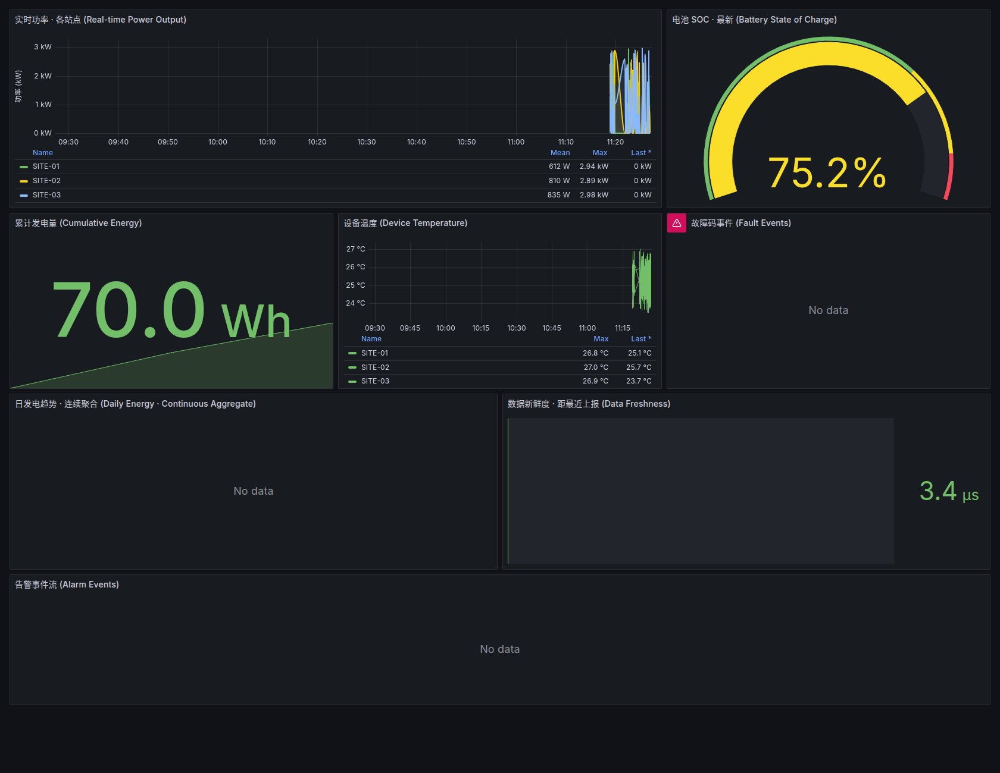

# Mini-Grid O&M Platform

> An operational monitoring platform for renewable **micro-grid O&M** — bringing up a complete data chain with a single command: **ingest → time-series storage → visualisation & alerting → self-healing → backup drills**.

[](https://docs.docker.com/compose/)
[](https://www.timescale.com/)
[](https://grafana.com/)
[](https://prometheus.io/)
[](LICENSE)

---

## What this is

A **working engineering implementation** built around the responsibilities of a real O&M System Engineer role, covering the digital backbone of a Remote Operations Centre (ROC).

> **Status — initial version (v1).** This project was deliberately built against the job description to prove the complete operational flow end to end and to assess what a production deployment would require. Site telemetry is currently **simulated**; the production version will be driven by real site requirements and real device connectivity. The architecture, alert-to-ticket loop and operational discipline carry over unchanged.

| Capability | Implementation | Operational duty |
|---|---|---|
| Data acquisition | `collector` service — simulator / Modbus / MQTT drivers | Monitoring & data-acquisition platform |
| Time-series storage | TimescaleDB (hypertable + continuous aggregates + compression + retention) | Data quality and storage governance |
| Visualisation | Grafana with provisioned datasources and dashboards | Dashboards & alarm management |
| **Two-line alerting** | 10 provisioned alert rules (OT device layer + IT platform layer) | Alarm management (P1 response KPI) |
| **Ticket closure** | `odoo-sync` opens Odoo Helpdesk tickets with priority and activity trail | Incident ownership & SLA tracking |
| Unattended self-healing | `watchdog` monitors ingest heartbeat and restarts the collector | 24/7 platform availability |
| Backup & restore | Scheduled `pg_dump` + one-command restore drill, status exposed on a dashboard | Backup and restoration (R/A scope) |
| Secure site access | WireGuard (wg-easy) with per-site keys and QR provisioning | Site connectivity & network segmentation |

**Design principle: low maintenance, unattended operation.** All long-running services use `restart: unless-stopped` plus healthchecks; database policies (compression, aggregate refresh, retention) register themselves at initialisation; Grafana datasources, dashboards and alert rules load from files on start. Once up, the platform runs without manual intervention.

---

## Architecture

```
  ┌──────────────── SITE LAYER (OT) ────────────────┐
  │  Inverters / Meters / BMS                      │
  │     │ Modbus TCP·RTU / MQTT / OPC-UA           │
  │     ▼                                          │
  │  collector  ← heartbeat file                   │
  └─────────────────┬──────────────────────────────┘
                    │  (WireGuard tunnel — encrypted)
                    ▼
  ┌──────────────── ROC — OPERATIONS CENTER ──────────────────┐
  │                                                           │
  │   collector ──▶ TimescaleDB ◀── grafana                   │
  │       ▲              ▲              │                     │
  │       │              │              ▼                     │
  │   watchdog      backup           dashboards + alerts      │
  │   (self-heal)   restore_drill    │                        │
  │                                  ├─▶ SMTP (e-mail)        │
  │   prometheus ◀─ docker-exporter  └─▶ odoo-sync ─▶ Odoo    │
  │   blackbox ── TCP/HTTP/TLS probes      (ticket + SLA)     │
  └───────────────────────────────────────────────────────────┘
```

Data path: **acquire → hypertable → continuous aggregates → dashboards & alerts → event record → RCA**

---

## Quick start

### Prerequisites

- Docker 20.10+ and Docker Compose v2
- At least 2 GB of available memory

### Bring it up

```bash
git clone git@github.com:yacobofwork/minigrid-ops-platform.git
cd minigrid-ops-platform
cp .env.example .env      # then edit passwords and SMTP settings
docker compose up -d
```

Or through the Makefile:

```bash
make up
```

### Endpoints

| Service | URL | Credentials |
|---|---|---|
| Grafana | http://localhost:3000 | `admin` / value of `GRAFANA_PASSWORD` in `.env` |
| Prometheus | http://localhost:9090 | — |
| WireGuard admin | http://localhost:51821 | value of `WG_PASSWORD` in `.env` |
| Odoo (optional profile) | http://localhost:8069 | create the database on first visit |

> `.env` is git-ignored and holds real credentials. Never commit it. `WG_PASSWORD` is mandatory — the compose file fails fast rather than falling back to a default password.

### Dashboards

Open Grafana → **Mini-Grid O&M** folder. Five dashboards ship with the repository:

| Dashboard | Purpose |
|---|---|
| `minigrid_overview` | Monitoring overview — real-time output per site, cumulative energy, device temperature, data freshness |
| `plant_overview` | Plant operations — generation now, energy today, battery SOC, devices in fault, recent fault table |
| `site_devices` | Site devices — PV / battery / genset / transformer detail per device |
| `platform_health` | Platform health — ingest rate, data freshness per site, backup status and history, database size |
| `host_health` | Host & containers — per-container CPU / memory / network / uptime, connectivity probes |



The simulator models four device classes per site: **PV-01** (solar array), **BAT-01** (battery storage), **GEN-01** (diesel genset) and **TR-01** (transformer).

---

## Alerting

Alert rules are provisioned from `grafana/provisioning/alerting/alert-rules.yml`. There are **10 rules**, deliberately split across two layers.

| Layer | Rule | Severity |
|---|---|---|
| OT device | Site data stale — monitoring gap (> 2 min) | **P1** |
| OT device | Inverter fault code reported | P2 |
| OT device | Battery SOC below 20% | P2 |
| IT platform | Connectivity probe failed | **P1** |
| IT platform | Core container stopped | **P1** |
| IT platform | Any container stopped | P2 |
| IT platform | Docker disk usage above 20 GB | P2 |
| IT platform | HTTP probe unhealthy | P2 |
| IT platform | Container memory above 80% of host | P3 |
| IT platform | TLS certificate expiring (< 14 days) | P3 |

Severity routing is defined in `policies.yml`: **P1** notifies immediately and repeats every 30 minutes until acknowledged; **P2** waits 5 minutes; **P3** is grouped. Every rule carries a `runbook_url` label, so the notification links straight to the procedure.

### Enabling e-mail

Fill in the SMTP block in `.env` (any provider works — corporate mailbox, transactional service or a Gmail app password):

```bash
SMTP_ENABLED=true
SMTP_HOST=smtp.example.com:587
SMTP_USER=you@example.com
SMTP_PASSWORD=your_app_password
SMTP_FROM=you@example.com
ALERT_EMAIL_TO=oncall@example.com
```

Then `docker compose restart grafana`. Without SMTP configured, alerts still fire and appear in Grafana — only delivery fails (visible in the Grafana log).

### Enabling Odoo tickets

```bash
ODOO_URL=https://your-instance.odoo.com
ODOO_DB=your-db
ODOO_EMAIL=you@example.com
ODOO_API_KEY=your_api_key
ODOO_TEAM=Mini-Grid O&M
SYNC_INTERVAL_SEC=60
```

`odoo-sync` polls firing alerts every 60 seconds and creates a Helpdesk ticket carrying the severity in the title, the alert payload in the description, and an owner — so a notice becomes a tracked task.

### Verifying data flow

```bash
# Collector log
docker compose logs -f collector

# Latest telemetry
docker compose exec -T timescaledb \
  psql -U ops -d minigrid -c \
  "SELECT site_id, count(*), round(max(power_kw)::numeric,2) AS max_kw FROM telemetry GROUP BY site_id;"
```

Record counts per site start increasing within about a minute.

---

## Common commands

```bash
make help                  # list all targets
make up                    # start the platform
make ps                    # service status
make health                # healthcheck summary
make logs                  # follow logs
make backup-restore-test   # run one backup/restore drill
make down                  # stop (data preserved)
make clean                 # stop and wipe data (destructive)
```

---

## Core automation

### 1. Unattended self-healing (watchdog)

`watchdog` checks the collector heartbeat file every 30 seconds. If the heartbeat is older than `HEARTBEAT_MAX_AGE_SEC` (default 90 s) on two consecutive checks, it restarts the collector through the Docker API and raises a P1 alert.

**Try it:**

```bash
docker stop mog-collector         # simulate a collector crash
# wait ~2 minutes
docker logs mog-watchdog          # "heartbeat expired → restart" entries
docker compose ps collector       # back to running (healthy)
```

If restarts exceed five within an hour, the watchdog escalates to *suspected persistent failure — manual intervention required* instead of looping.

> **Note for drills:** to observe a *monitoring-gap alert*, stop the watchdog **first**, then the collector. Otherwise self-healing restores the collector within 60 seconds and the alert never fires — which is the system working as designed.

### 2. Scheduled backup and restore drill

The `backup` service runs `pg_dump` every `BACKUP_INTERVAL_HOURS`, rotates files by `BACKUP_RETENTION_DAYS`, and writes `backup.log` to the backup volume. Dashboard panels read that history, so the measure is **when the last backup succeeded**, not whether a file exists.

Run a drill with one command:

```bash
make backup-restore-test
```

The script backs up, records source row counts, restores into a temporary database, verifies consistency, cleans up and prints a report.

> **Lesson baked into the script:** TimescaleDB restores must call `timescaledb_pre_restore()` before and `timescaledb_post_restore()` after the restore. Skip them and the internal time-series tables never reattach to the hypertable — the restore "succeeds" but main-table queries return zero rows. The drill script follows the official sequence; this is exactly why drills exist.

---

## Project structure

```
minigrid-ops-platform/
├── docker-compose.yml              # 10 services, healthchecks, two networks
├── Makefile                        # day-to-day operations
├── .env.example                    # environment template (safe to commit)
├── db/
│   ├── init/01_schema.sql          # hypertable, aggregates, compression, retention
│   └── migrate_001_energy_delta.sql# migration for existing deployments
├── services/
│   ├── collector/                  # ingest → database, heartbeat
│   │   ├── collector.py
│   │   ├── sources.py              # simulator / modbus / mqtt abstraction
│   │   └── Dockerfile
│   ├── watchdog/                   # heartbeat monitor + self-healing
│   ├── docker_exporter/            # custom exporter, parallel container stats
│   └── odoo_sync/                  # alert → Odoo Helpdesk bridge
├── grafana/
│   ├── provisioning/               # datasources, alerting, dashboard provider
│   └── dashboards/                 # five dashboard JSON files
├── prometheus/prometheus.yml       # scrape config, blackbox jobs
├── monitoring/blackbox.yml         # TCP / HTTP / TLS probe modules
├── scripts/
│   ├── backup_loop.sh
│   ├── restore_drill.sh
│   └── odoo_push.py
└── runbooks/                       # operational procedures
```

---

## Runbooks

Every alert links to one of these written procedures:

| Runbook | Purpose |
|---|---|
| [Server rebuild](runbooks/server-rebuild.md) | Recover the platform from scratch after host loss |
| [VPN recovery](runbooks/vpn-recovery.md) | Diagnose and restore site connectivity |
| [Data restore](runbooks/data-restore.md) | Recovery after database corruption or accidental deletion |
| [Incident response](runbooks/incident-response.md) | P1 handling following the six NIST SP 800-61 phases |
| [Connect a real device](runbooks/connect-real-device.md) | Move from simulator to Modbus / MQTT devices |

---

## Technology stack

- **TimescaleDB** (PostgreSQL 16) — time-series storage, continuous aggregates, compression, retention
- **Grafana 11** — dashboards, alerting, file-based provisioning
- **Prometheus + Alertmanager** — metrics collection and severity routing
- **blackbox_exporter** — TCP, HTTP and TLS-certificate probes
- **Python 3.11** — collector, watchdog, docker-exporter, odoo-sync
- **WireGuard (wg-easy)** — encrypted site access with per-site keys
- **Docker Compose** — orchestration, healthchecks, self-healing

---

## Verification record

Measured on the reference deployment:

| Item | Result |
|---|---|
| Bring-up of 10 services | All `Up`; timescaledb, grafana and collector `healthy` |
| Data flow | Three sites writing continuously; ~144 rows/min steady state |
| Time-series modelling | Hypertable + 2 continuous aggregates + compression and retention registered |
| Grafana provisioning | 5 dashboards and 10 alert rules loaded automatically from files |
| Data freshness | 2–5 s end to end |
| Watchdog self-healing | Collector restored within 120 s of being stopped |
| Backup & restore drill | `PASS`, zero data loss |
| Alert-to-ticket | P2 inverter-fault alert created an Odoo ticket, assigned and solved |

### A correctness fix worth noting

Two units were originally conflated: `power_kw` is an instantaneous **gauge** while `energy_kwh` is a cumulative **counter**. Summing a gauge across rows inflated 20 kW into 240 kW; summing a counter produced implausible megawatt-hour totals. The fix sums the **latest value per device** for power, and uses `MAX − MIN` window deltas for energy — in the dashboards and inside the continuous aggregates.

---

## Extending the platform

- [ ] Connect real inverters and meters (`sources.py` already provides the Modbus / MQTT skeleton)
- [ ] Add host-level monitoring with `node_exporter`
- [ ] Introduce Suricata or Wazuh for IDS and log auditing
- [ ] Complete IEC 62443 zone-and-conduit documentation for site and ROC networks
- [ ] Automate provisioning with Ansible for the in-house server migration
- [ ] Replace the energy counter with incremental reporting so restarts no longer reset daily totals

---

## Known limitations (v1)

- Site telemetry is **simulated**; no real device has been integrated yet.
- Energy counters reset when the collector restarts, which under-reports "energy today" after a restart.
- Alert thresholds are derived from operating logic, not yet tuned against real baselines.
- Security hardening is modelled (zoning, VPN, least privilege) but firewall/IDS and image scanning are not yet in place.

## License

MIT — see [LICENSE](LICENSE)
